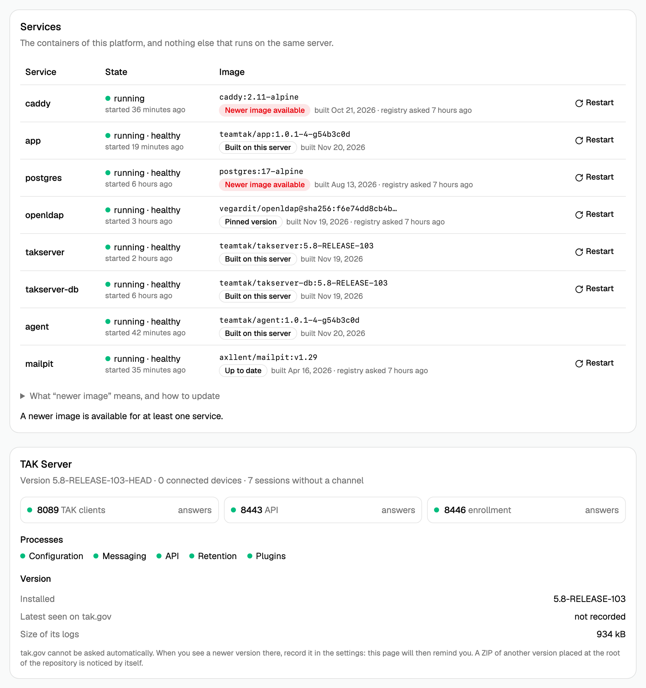
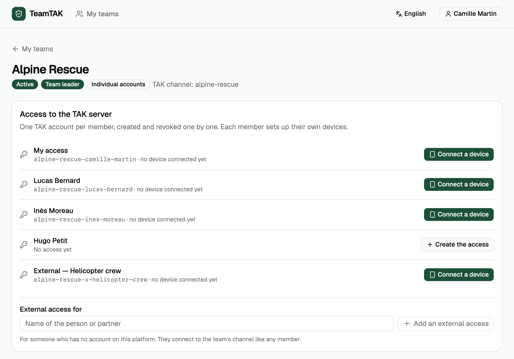
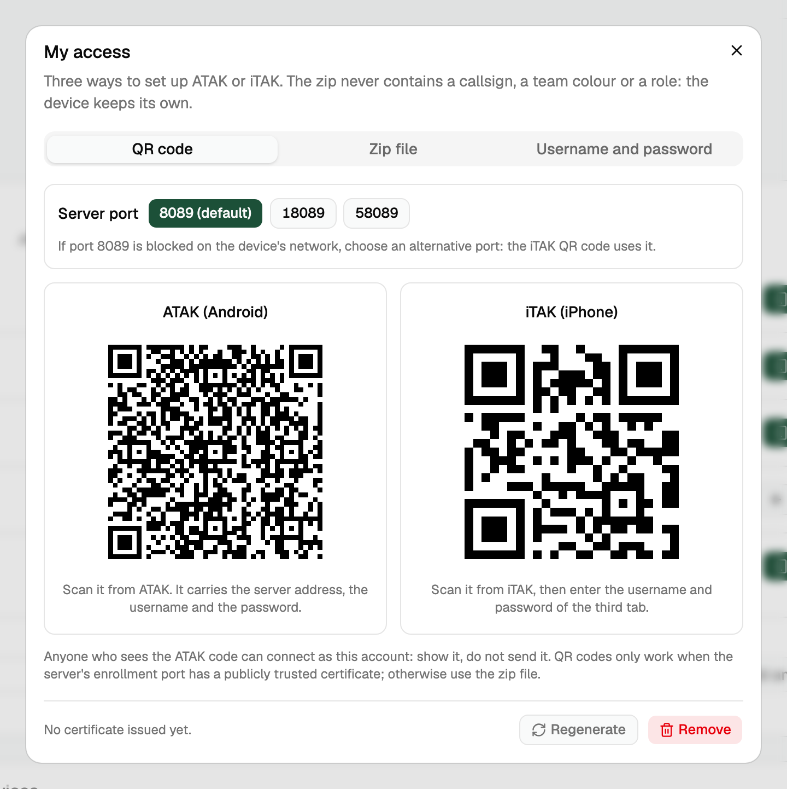
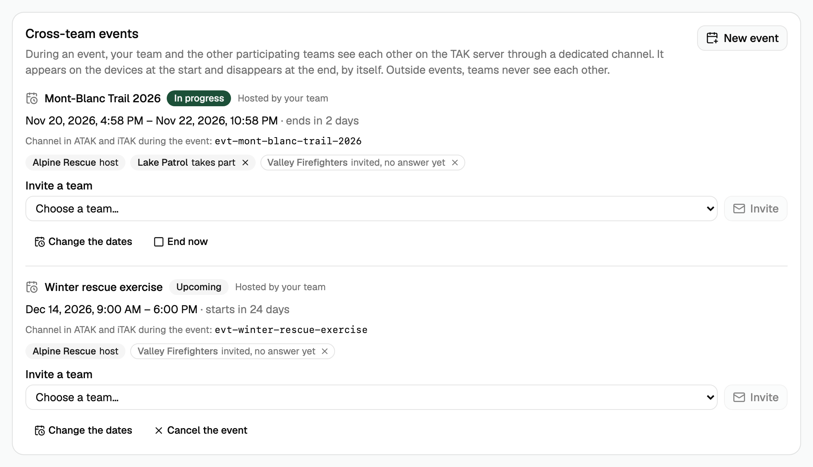

# TeamTAK

**Install an official TAK Server, keep watch over it and keep it up to date, then share it with a
community of teams.**

TeamTAK sets up an official [TAK Server](https://tak.gov), the Docker release published on tak.gov,
on one Linux server. One script does the whole install, TAK Server included: it asks a few
questions, shows a summary, and does the rest. Afterwards, TeamTAK keeps watch over the server,
warns the administrator when something goes wrong, and says when an update is waiting, for TAK
Server as for the rest, with the command that applies it.

On top of that server, TeamTAK adds what a community needs (an association, a network of volunteer
teams, a group of clubs or units): people sign in with their e-mail, teams form and run themselves,
connection files are generated ready to import into ATAK and iTAK, and events bring teams together
for a time.

## Install, watch, update

For whoever runs the server, this is the heart of TeamTAK: getting TAK Server running without
reading its whole installation guide, and keeping it healthy and current afterwards.

- **A guided install.** One script, questions with a default for each, and nothing written before
  you confirm the summary. It builds the TAK Server images from the ZIP you downloaded from tak.gov
  (the version is read from the ZIP), creates the certificate authority, TAK Server's certificates
  and its configuration, puts HTTPS in front with Let's Encrypt, starts everything with Docker
  Compose and creates the first administrator. If a step fails, it says which and resumes from
  there on the next run.
- **Guided TAK Server upgrades.** Put the ZIP of a newer version next to the installed one and run
  `sudo ./install.sh --upgrade-tak`: it takes a backup, builds the new images, checks that the
  database can follow before changing anything, restarts and checks that TAK Server answers.
- **Told when an update is waiting.** The monitoring page lists what can be updated (TeamTAK, TAK
  Server, the other images, the server's packages) with the command for each, and an e-mail goes
  out when a new TeamTAK release is out. Nothing is updated from the web UI, on purpose.
- **Monitoring and alerts**: the machine, the services, TAK Server, the certificates and the
  connected devices, with e-mail alerts and an optional webhook.
- **Daily backups**, optionally encrypted, and a tested restore.
- **Always in line**: the platform's database is the reference; the directory and TAK Server are
  corrected to match it, and any drift is reported.
- **TAK Server's own administration pages** stay within reach of the platform's administrators,
  behind their sign-in.
- **Audit log** of every action that changes something.



## Built for a community of teams

This is what sets TeamTAK apart from a plain TAK Server: the server is shared by many teams, and
each team runs itself. The administrator approves new teams; everything else happens without them.

1. **Sign in with an e-mail address.** No password to remember: a six-digit code arrives by e-mail.
   Anyone can sign in, but an account gets no TAK access until it belongs to a team.
2. **Ask for a team.** A future leader asks for one and an administrator approves it, with a cap on
   its members. It is the only step that needs an administrator.
3. **Bring the team in.** The leader invites the members by e-mail, removes them, and chooses how
   the team connects: one shared identity, one account per member, or named accesses for people
   outside the platform.

   

4. **Connect without setting anything up.** TeamTAK generates each access ready to use: a QR code
   to scan, a zip (data package) to import into ATAK or iTAK, with or without a client
   certificate, or a username and password. The leader creates, regenerates or withdraws them, and
   sees which devices are connected. In ATAK and iTAK the team is one channel, private to it.

   

5. **Work together at events.** A leader creates an event and invites other teams; each team
   accepts or declines. From the start of the event to its end, a shared channel appears on every
   device, then goes away, without anyone reconnecting.

   

The UI and the e-mails are in English and French; other languages are two files away.

If you are the one installing TeamTAK, the [Installation](#installation) and
[Updating](#updating) guides below are all you need.

## Requirements

- A Linux server, amd64, with **8 GB of RAM** and about **12 GB of disk** for the images.
  **Ubuntu Server LTS (24.04)** is the recommended system.
- **Docker with Compose v2**, plus `git`, `unzip`, `bash` and `openssl`.
- **The TAK Server Docker ZIP**, `takserver-docker-hardened-<version>.zip`, from
  [tak.gov](https://tak.gov) (a free account is needed to download it). No version is fixed: the
  install reads it from the ZIP, so take the latest one (TeamTAK has been tested with
  `5.8-RELEASE-103`). It is under the tak.gov licence, so it is not in this repository and must
  never be committed (`.gitignore` excludes it). No Iron Bank account and no `docker login` are
  needed.
- For production: a **domain name** pointing to the server, and an **SMTP account** to send the
  login codes (Brevo, for example).

## Installation

### Production

**1. Prepare the server.** On Ubuntu Server 24.04 LTS, install Docker Engine and its Compose
plugin by following [Docker's instructions for Ubuntu](https://docs.docker.com/engine/install/ubuntu/),
then the tools the scripts use:

```bash
sudo apt update && sudo apt install -y git unzip openssl
```

**2. Point the domain and open the ports.** Create a DNS record for the domain (for example
`tak.example.org`) that points to the server, and open these ports in the firewall: 80/tcp,
443/tcp and 443/udp (web), 8089/tcp (TAK clients, plus any other client port you choose at step 5),
8446/tcp (enrollment) and 8443/tcp (TAK Server's administration pages, for the platform's
administrators: [TAK Server's administration](docs/configuration.md#tak-servers-administration)).
The domain must
resolve before the install runs, because Caddy asks Let's Encrypt for the certificate as soon as it
starts.

**3. Get the code.**

```bash
git clone https://github.com/Titou74/teamtak.git
```

```bash
cd teamtak
```

The clone holds `main`, where development goes on. You do not have to pick a version: the install
moves the checkout to the latest release by itself (step 5).

**4. Add the TAK Server ZIP.** Download the latest `takserver-docker-hardened-<version>.zip` from
tak.gov and put it at the root of the repository. From your own computer, for example:

```bash
scp takserver-docker-hardened-*.zip user@tak.example.org:teamtak/
```

If several ZIPs are there, the install asks which one to use (the newest by default). Without a
ZIP at the root, it asks for the path of one.

**5. Run the install**, as root:

```bash
sudo ./install.sh
```

It asks its questions one by one, with the default in brackets (Enter keeps it):

| Question | Answer |
|---|---|
| Mode | `1`, production |
| Domain name | `tak.example.org` |
| Ports for TAK clients | `8089` by default; add others, separated by commas, for networks that block 8089, or replace it if another program uses it ([Client ports](docs/configuration.md#client-ports)) |
| E-mail address of the first administrator | your address |
| Contact address given to Let's Encrypt | the administrator's by default |
| Validity of TAK client certificates | 365 days by default |
| Let's Encrypt certificate on port 8446 | `y` if phones will enroll by QR code ([QR codes and port 8446](docs/architecture.md#qr-codes-and-port-8446)) |
| SMTP server, port, encryption, username, password, sender | your SMTP account, `smtp-relay.brevo.com`, 587 and starttls for Brevo |

It then shows a summary and writes nothing before you answer yes. The script builds the two TAK
Server images from the ZIP, generates the secrets (`deploy/.env`), a certificate authority and
TAK Server's certificates (`deploy/data/`), builds the platform and agent images, starts
everything, declares the platform's certificate as TAK Server administrator, and creates the first
administrator. Allow ten minutes the first time, one minute afterwards.

Every answer can be given in advance as an option ([Install options](#install-options)); the
script then only asks for the others. To install with no question at all, from a script for
example, add `--non-interactive`:

```bash
sudo ./install.sh --non-interactive --domain tak.example.org --admin-email you@example.org --smtp-host smtp-relay.brevo.com --smtp-port 587 --smtp-username 'SMTP_LOGIN' --smtp-password 'SMTP_KEY' --mail-from 'TeamTAK <no-reply@example.org>'
```

**6. Sign in.** The script ends by printing the address of the UI and a one-time login code for
the administrator. Open `https://tak.example.org`, type the administrator's address, choose
"I already have a code" and enter it. TAK clients connect to `tak.example.org:8089`.

**7. Protect what was generated.** Three paths now hold everything that cannot be rebuilt. None is
versioned, and none should ever be shared:

| Path | Holds |
|---|---|
| `deploy/.env` | Settings and every secret, `APP_SECRET` among them |
| `deploy/data/` | The certificate authority, TAK Server's certificates and configuration, Caddy's certificates |
| `deploy/backups/` | The daily archives, which contain the two above and the three databases |

In **Monitoring, Settings**, set a backup passphrase, then arrange for the archives to leave the
server ([Copying the archives elsewhere](docs/backups.md#copying-the-archives-elsewhere)).

**8. Welcome the first teams.** Share the address of the UI with the community: each future team
leader signs in and asks for their team, and you approve it from the administration area.

### Local mode (development, tests, first look)

With Docker running and the ZIP at the repository root:

```bash
./install.sh --local
```

It asks for the address TAK clients use, their ports, the administrator's address and the
certificate validity.
Keep `localhost` for this computer only; to let phones on the same network reach TAK Server, give
the machine's LAN address (the script shows it): the server certificate then carries it and the
ports listen on all interfaces.

It ends by printing the address of the UI (`http://localhost:8480`) and a one-time login code for
the administrator. Other login codes arrive in the mail catcher at `http://localhost:8025`. On
Linux, run it with `sudo`.

Local mode installs the code of the checkout as it is, `main` or the branch being worked on; add
`--release latest` to install the latest release instead.

Without questions:

```bash
./install.sh --local --host 192.168.1.20 --admin-email you@example.org --non-interactive
```

### Install options

| Option | Meaning | Default |
|---|---|---|
| `--local` / `--domain <name>` | Mode: local, or production for this domain | local |
| `--host <name-or-ip>` | Local mode: address TAK clients use | `localhost` |
| `--admin-email <address>` | First administrator | none |
| `--cert-validity-days <n>` | Validity of TAK client certificates | 365 |
| `--tak-client-ports <list>` | Ports TAK clients connect to, separated by commas; the first goes into the zips and QR codes ([Client ports](docs/configuration.md#client-ports)) | `8089` |
| `--tak-admin-port <port\|off>` | Port where the platform's administrators open TAK Server's own administration pages, after signing in ([TAK Server's administration](docs/configuration.md#tak-servers-administration)) | `8443` |
| `--tak-enroll-letsencrypt` | Production: Let's Encrypt certificate on port 8446 | off |
| `--smtp-host`, `--smtp-port`, `--smtp-username`, `--smtp-password`, `--smtp-tls`, `--mail-from` | Outgoing e-mail | mail catcher in local mode |
| `--acme-email <address>` | Contact given to Let's Encrypt | the administrator's |
| `--zip <path>` | TAK Server ZIP, of any version | the one at the repository root; the newest if there are several (asked in a terminal) |
| `--upgrade-tak` | Move the installation to a newer TAK Server ([Upgrading TAK Server](#upgrading-tak-server)) | |
| `--release <version\|latest\|current>` | TeamTAK release to install (`1.0.4`), moving the checkout to its tag first. `latest`: the newest release, pre-releases left out; `current`: the code as it is ([Updating TeamTAK](#updating-teamtak)) | `latest` in production, `current` in local mode |
| `--non-interactive` | Ask nothing: options not given take their default | on when the script does not run in a terminal |
| `--no-start` | Prepare everything without starting | |

The settings are asked, or read from the options, on the **first run only**. Afterwards they live
in `deploy/.env` ([configuration](docs/configuration.md)): edit that file and run `./install.sh`
again to apply a change (in production, that run also moves TeamTAK to its latest release; add
`--release current` to apply the change alone). The script is safe to run again; it asks nothing
and keeps existing settings, certificates and images. The ZIP is only read again when the TAK Server images have to
be rebuilt.

### If the install stops

The script says which step failed and prints the end of the relevant log. Fix the cause and run the
same command again: it resumes from what already exists. If login codes do not arrive, the rescue
command prints one without e-mail:

```bash
cd deploy && docker compose exec app teamtak grant-admin you@example.org
```

## Updating

There are five things to keep up to date. The monitoring page tells when each of them has
something waiting; nothing is ever updated from the web UI, on purpose.

| What | How | Said by the monitoring page |
|---|---|---|
| TeamTAK itself | `sudo ./install.sh`, which gets the latest release ([below](#updating-teamtak)) | "TeamTAK … is available", and an alert e-mail |
| Caddy, PostgreSQL, the mail catcher | `cd deploy && docker compose pull && docker compose up -d` | "Newer image available" |
| The directory (OpenLDAP) | Pinned by digest in `deploy/docker-compose.yml`: change the digest, test, then `./install.sh` | "Pinned; a newer build exists" |
| The server's packages | `sudo apt update && sudo apt full-upgrade`, then `sudo reboot` if asked | pending updates, security updates, restart required |
| TAK Server | [Upgrading TAK Server](#upgrading-tak-server) | "TAK Server … is available", or a ZIP of a newer version at the repository root |

### Updating TeamTAK

TeamTAK's versions are published as [releases on GitHub](https://github.com/Titou74/TeamTAK/releases),
with what each one changes. The platform asks GitHub twice a day: when a newer release is out, the
**Monitoring** page says so, with the update command, and the administrators get an alert e-mail.
The installed version is on the same page, and in the output of `teamtak status` and of the install.

Run from the root of the repository, on the server.

**1. Take a backup.** It is the way back if the new version does not suit you.

```bash
sudo deploy/scripts/backup.sh
```

**2. Install the new version.**

```bash
sudo ./install.sh
```

The script first fetches the releases from GitHub and moves the checkout to the latest one (its
tag, `v1.0.4` for example; pre-releases are left out), then runs as that version. An installation
made from `main` moves to the release the same way. To install a given release instead, the one the
**Monitoring** page names for example:

```bash
sudo ./install.sh --release 1.0.4
```

No other option is needed: the script reads `deploy/.env`. It keeps the settings, the secrets, the
certificate authority and the TAK Server images, adds to `deploy/.env` the settings a new version
introduces, rebuilds the platform and agent images, tagged with the new version taken from git
(`teamtak/app:<version>`), and restarts the services that changed; the images of the previous
version are removed at the end. The
platform applies its database migrations by itself when it starts. The script then runs the same
checks as a first install and stops with an error if the platform cannot reach the directory or
TAK Server.

If files of the repository were changed by hand, the script stops and lists them rather than
overwrite them. Without access to GitHub it says so and installs from the releases the checkout
already knows. An installation ahead of the latest release (from `main` between two releases) is
left where it is.

**3. Check.** The **Monitoring** page should show every service running, and:

```bash
cd deploy && docker compose exec app teamtak status
```

**Going back.** Database migrations are not undone by returning to older code. Install the previous
release (`sudo ./install.sh --release 1.0.2`, for example), then restore the archive of step 1
([Restoring](docs/backups.md#restoring)).

**In local mode** the install keeps the code as it is, since it is usually the code being
developed: update with `./install.sh --release latest`.

### Upgrading TAK Server

tak.gov has no way to be asked automatically. Record in **Monitoring, Settings** the latest
version you saw there; the monitoring page then says when it is newer than the installed one. It
also notices by itself a ZIP of a newer version at the repository root.

1. Download `takserver-docker-hardened-<new version>.zip` from tak.gov and put it at the root of
   the repository, next to the installed one. `./install.sh` points it out on its next run.
2. Read the release notes of that version for changes to `CoreConfig.xml`.
3. Run the upgrade:

```bash
sudo ./install.sh --upgrade-tak
```

It picks the ZIP newer than the installed version (if there are several, it asks which one; from
a script, give it with `--zip <path>`), shows both versions and waits for a yes. A ZIP of an older
version is refused. It then takes a backup, builds the two images of the new version, checks
that the new database image runs the same major version of PostgreSQL as the installed one (it
stops before changing anything otherwise), writes the new version in `deploy/.env`, and restarts
the stack; TAK Server's database image upgrades its own schema when it starts. It then checks that
the platform reaches TAK Server, as a normal install does.

The ZIP of the old version can then be deleted: a ZIP is only read to build missing images. Keep
it, though, if you may go back.

To go back: put `TAK_VERSION`, `TAK_IMAGE` and `TAK_DB_IMAGE` back to the old version in
`deploy/.env` and run `sudo ./install.sh`. If the new version already changed the database, restore
the backup taken at step 3 instead.

If the PostgreSQL versions differ, the data volume cannot be reused as it is: take a backup, remove
the volume `teamtak_tak-db-data`, start the new version on an empty database, and load
`takserver.dump` of the backup into it with `pg_restore`.

**This procedure could not be tested**: only one TAK Server ZIP exists so far. The steps it is
built from (backup, image build, start, checks) are the ones the install and the restore run.

## Documentation

Everything else is in [`docs/`](docs/README.md):

- [Architecture](docs/architecture.md): services, ports, how teams, accesses, events and
  reconciliation work
- [Configuration](docs/configuration.md) of `deploy/.env`
- [Day-to-day commands](docs/operations.md)
- [Monitoring, alerts and audit log](docs/monitoring.md), webhook format included
- [Backups and restore](docs/backups.md)
- [Development](docs/development.md) and [testing](docs/testing.md)
- The [specification](docs/PLAN.md) and the reports of each development phase
